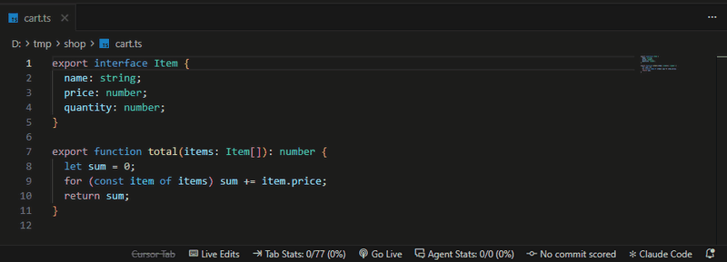

# Live Edits for Claude Code

Watch Claude Code type its edits into your editor, letter by letter.

With an AI agent writing the code, it is easy to feel like a spectator. Live Edits
slows the moment down: before each change lands, the file opens next to your chat,
the lines about to change light up, the old text is backspaced away, and the new code
is typed in at a readable pace. Then the file closes and you are back in the chat.

Works in **VS Code**, **Cursor** and other VS Code-based editors, on Windows, macOS
and Linux, with the Claude Code extension or the `claude` CLI in the integrated
terminal.

## What an edit looks like

1. The file opens beside the chat. The lines about to change are highlighted **red**.
2. The exact text being removed is struck through, then backspaced letter by letter.
3. The replacement is typed in with a human rhythm: short pauses after punctuation,
   longer ones at line ends, indentation arriving at once like auto-indent.
4. Claude's real edit is saved. The new lines stay highlighted **green** for a moment.
5. The file closes (only if Live Edits opened it) and focus returns to the chat.

New files and long functions are typed out in full at the same readable pace. While
an edit plays, the status bar shows **Typing app.ts…**; click it to finish that edit
instantly. If you'd rather have long edits speed up, turn on `liveEdits.speedUpLongEdits`.

## Getting started

1. Install the extension.
2. Click **Turn on** in the prompt, or run **Live Edits: Turn On for Claude Code** from
   the Command Palette.
3. Start a new Claude Code chat and ask for a change.

Turning it on adds three hooks to `~/.claude/settings.json` (a backup is kept as
`settings.json.live-edits.bak`). Everything else in that file is left as it is.

The status bar shows **Live Edits**. Click it to pause (edits apply instantly) or resume.

## Settings

| Setting | Default | What it does |
|---|---|---|
| `liveEdits.enabled` | `true` | Pause or resume without removing the hooks |
| `liveEdits.typingSpeed` | `14` | Characters per second when typing |
| `liveEdits.deleteSpeed` | `16` | Characters per second when backspacing |
| `liveEdits.pauseBefore` | `1.8` | Seconds of red highlight before anything is deleted |
| `liveEdits.pauseAfter` | `2` | Seconds of green highlight after the edit |
| `liveEdits.speedUpLongEdits` | `false` | Speed up edits that would take longer than the cap below |
| `liveEdits.maxTypingSeconds` | `45` | With speed-up on: the most time one edit may take |
| `liveEdits.closeFilesAfterEdit` | `true` | Close files Live Edits opened |
| `liveEdits.returnToChat` | `true` | Switch back to the Claude chat after the last edit |

## How it works

Claude Code supports hooks that run before and after each tool. Live Edits registers `http` hooks for the `Edit`,
`Write` and `MultiEdit` tools that point at a small server the extension runs on
`127.0.0.1`. Claude Code waits for the server's reply, so the animation plays before
the real edit is written.

- The typing happens in the editor's **unsaved buffer**. When Claude's real edit lands,
  the buffer is reloaded from disk. The text is identical, so nothing jumps.
- If the edit fails or is denied, the buffer is put back as it was.
- With several editor windows open, the edit is shown in the window whose workspace
  contains the Claude session's folder.
- When no editor is running, Claude Code can't reach the server and simply carries on.

## Safety and privacy

- Nothing leaves your machine. The server listens on `127.0.0.1` only.
- Every request must carry a random token stored in `~/.claude/live-edits/bridge.json`
  and in the hook settings, so other programs and web pages can't drive your editor.
- Files with your own unsaved changes are never retyped, only highlighted.
- If you save a file while its edit is still being typed, the real contents are put
  back on disk immediately, so a half-typed file is never left saved.
- If `files.autoSave` is on, typing is skipped (auto-save could save a half-typed file);
  you still get the red and green highlights.

## Limitations

- Only edits made with Claude's file tools are shown. Changes made by shell commands
  (formatters, code generators, `sed`) apply as usual without animation.
- Remote setups (SSH, WSL, containers) where Claude Code runs on a different machine
  from the editor aren't supported yet.
- Edits take longer, by design: a new 200-line file takes a few minutes. Skip a single
  edit or pause entirely from the status bar when you need speed. Even with speed-up
  off, one edit only speeds up past 12 minutes, so Claude Code never gives up waiting.

## Removing it

Run **Live Edits: Remove from Claude Code**, or uninstall the extension; uninstalling
removes the hooks from `~/.claude/settings.json` too.

## Disclaimer

Live Edits is an independent project and is not affiliated with or endorsed by
Anthropic. Claude and Claude Code are trademarks of Anthropic, PBC.

## License

[MIT](LICENSE)
